I'm a fullstack developer at OPT (Optimização e Planeamento de Transportes), working on software that helps get public transport information to passengers.

**Find me on [LinkedIn](https://www.linkedin.com/in/daniel-santos-8bb581169/)**

 

 

 

 

